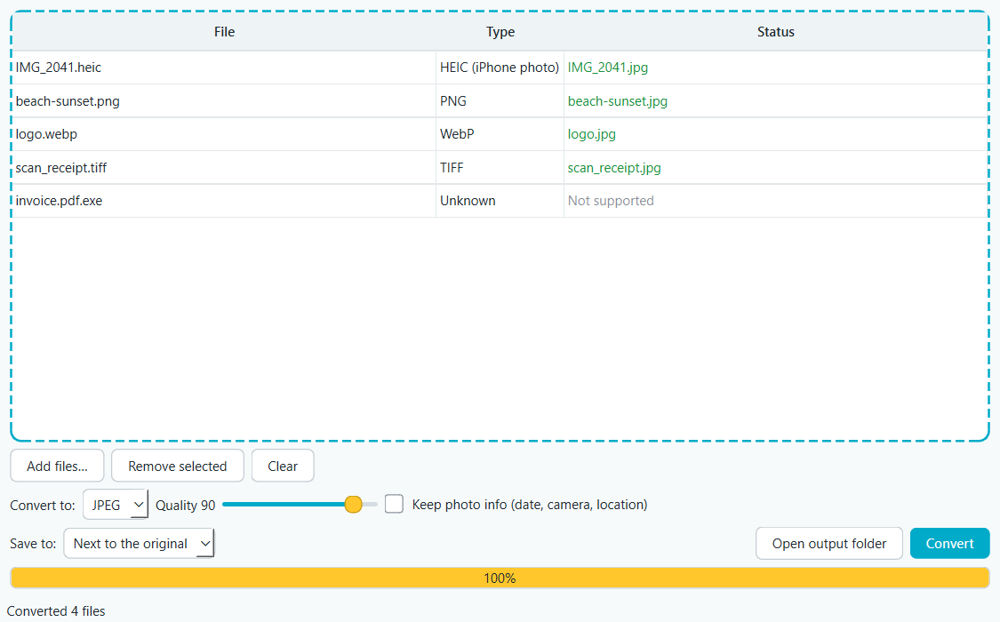

# File Type Converter

A Windows desktop app for converting files between formats. Drop files in, pick a format, done. Everything runs on your PC; nothing gets uploaded anywhere.



## What it converts (v0.1)

| From | To |
|---|---|
| Images: PNG, JPEG, WebP, GIF, BMP, TIFF, ICO, **HEIC (iPhone photos)** | PNG, JPEG, WebP, GIF, BMP, TIFF, ICO |
| Excel (.xlsx) | CSV, JSON |
| CSV | Excel, JSON |
| JSON | CSV, Excel |

Audio/video (v0.2) and documents like Word and PDF (v0.3) are next.

## How it handles your files

- **Your originals are never touched.** The converted copy is saved next to the original (or in a folder you pick). If `photo.jpg` already exists, you get `photo (1).jpg`.
- **It checks what a file really is**, not just its name. A PNG renamed to `.jpg` is treated as a PNG, and anything it can't read, like a program disguised as `invoice.pdf.exe`, is marked unsupported and left alone.
- **Photo location stays private.** Converted photos drop their hidden info (GPS location, camera, date) unless you tick "Keep photo info".
- **No half-written files.** If a conversion fails partway, nothing is left behind.
- **Phone photos come out the right way up**, and transparent images get a white background when converted to formats without transparency (JPEG, BMP).
- **Spreadsheets keep their data intact.** Values like ZIP codes `00123`, long card or account numbers, and codes like `1E5` stay exactly as written. Multi-sheet workbooks become one CSV per sheet.
- **Imported text can't become a live formula.** Text like `=HYPERLINK(...)` stays text in Excel files, and gets a protective `'` in CSV files so Excel won't run it.

## Run it

Needs Python 3.11+.

```bash
python -m venv .venv
.venv\Scripts\activate
pip install -r requirements.txt
python main.py
```

You can also pass files to open straight away: `python main.py photo.heic data.csv`.

## Develop

```bash
pip install -r requirements-dev.txt
pytest
python tools/screenshot.py   # regenerate docs/screenshot.png
```

```
converter/
  formats.py     known formats + detecting what a file really is
  registry.py    which conversions exist, and running one
  images.py      image conversion (Pillow, pillow-heif)
  data.py        Excel / CSV / JSON conversion (openpyxl)
  paths.py       output naming and safe writes
  ui/            the PySide6 window and background worker
tests/           pytest suite, including a test that drives the real window
```

## Roadmap

- [x] v0.1: window, drag and drop, images, spreadsheets
- [ ] v0.2: audio and video (FFmpeg)
- [ ] v0.3: documents (Word, PDF, Markdown, HTML)
- [ ] v1.0: Windows installer on the Releases page

## License

[MIT](LICENSE)
